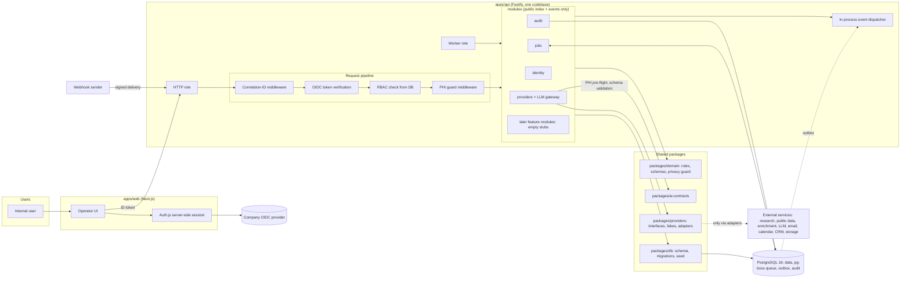
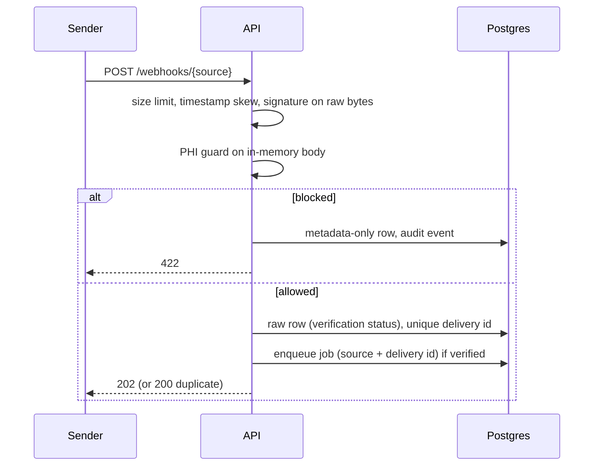

# Architecture Overview — Foundation (Feature 001)

Modular monolith: one API codebase running HTTP and worker roles, an internal web app, and PostgreSQL as the single system of record (data, job queue, outbox). See [ADR-001](../adr/ADR-001-modular-monolith.md), [ADR-002](../adr/ADR-002-postgresql-system-of-record.md), [ADR-004](../adr/ADR-004-non-phi-data-boundary.md), [ADR-006](../adr/ADR-006-provider-adapter-pattern.md), [ADR-013](../adr/ADR-013-transactional-outbox.md) and [ADR-014](../adr/ADR-014-company-oidc-authentication.md).

## Component diagram



## Key flows

### Authorised state change
```mermaid
sequenceDiagram
  participant W as Web
  participant A as API
  participant D as Postgres
  W->>A: request + ID token + Idempotency-Key
  A->>A: correlation ID, verify token
  A->>D: load user, roles, permissions (every request)
  A->>A: PHI guard on body
  A->>D: BEGIN; change + audit_event + outbox_event; COMMIT
  A-->>W: result (denied → 403 + audit event)
```

### Webhook ingress


## Boundaries enforced by lint
- Modules import only another module's public `index.ts`, or react to its events.
- Rule modules in `packages/domain` cannot import `packages/providers` or `packages/ai-contracts` (deterministic rules, never an LLM).
- Vendor SDKs are importable only inside provider adapters.
- No real network access in tests.

## Out of scope here
GTM business modules (accounts through analytics) exist as empty folders; cloud deployment target is deferred (open question #16).
